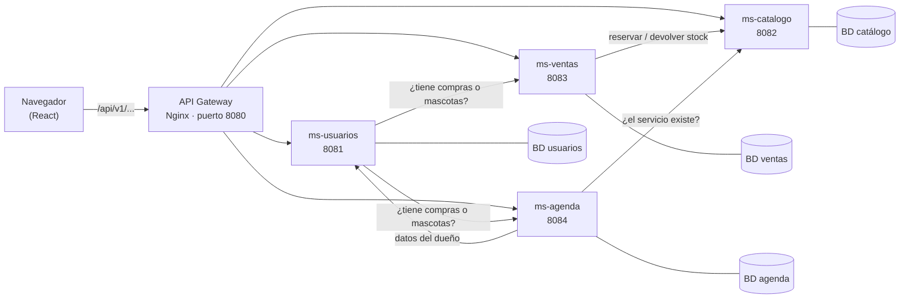
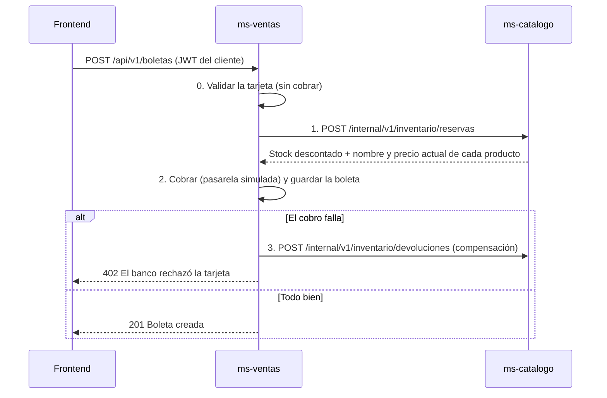

# VetSM Backend: microservicios de la Veterinaria San Marcos

Backend de la Veterinaria San Marcos, desarrollado con Spring Boot para la asignatura DSY1104
Desarrollo Fullstack II (DuocUC). Son **cuatro microservicios** detrás de un **API Gateway**, cada uno
con su propia base de datos. El frontend en React vive en un repositorio aparte.

## Cómo ejecutar

### Con Docker (recomendado: un solo comando)

Requiere [Docker Desktop](https://www.docker.com/products/docker-desktop/).

```bash
docker compose up --build
```

La primera vez tarda unos minutos (descarga las dependencias y compila). Después:

- **API (gateway):** <http://localhost:8080/api/v1/...>
- **Swagger de los cuatro servicios:** <http://localhost:8080/swagger-ui.html> (selector arriba a la derecha)
- **Frontend:** en el repositorio del frontend, `npm run dev` y abrir <http://localhost:3000>

Para apagar todo: `docker compose down`.

### Sin Docker

Se compila todo y se levanta cada servicio en su puerto (en cuatro terminales):

```bash
./mvnw clean package -DskipTests
java -jar ms-usuarios/target/ms-usuarios.jar     # puerto 8081
java -jar ms-catalogo/target/ms-catalogo.jar     # puerto 8082
java -jar ms-ventas/target/ms-ventas.jar         # puerto 8083
java -jar ms-agenda/target/ms-agenda.jar         # puerto 8084
```

En el frontend se usa `npm run dev:sin-docker`, que reparte las rutas directo a cada puerto (sin
gateway). En Windows se usa `mvnw.cmd` en lugar de `./mvnw`.

### Cuentas de demostración

| Rol | Correo | Contraseña |
|---|---|---|
| Administrador | `admin@sanmarcos.cl` | `Admin123!` |
| Recepcionista | `recepcion@sanmarcos.cl` | `Recep123!` |
| Cliente | `ana.garcia@correo.cl` | `Cliente123!` |

Solo existen en el perfil de desarrollo (`h2`); con Oracle las contraseñas iniciales vienen de variables de entorno.

## Arquitectura



| Servicio | Responsabilidad | Tablas propias | Llama a |
|---|---|---|---|
| **ms-usuarios** | Cuentas, inicio de sesión, **emisión de los JWT**, renovación de sesión y perfil | `usuario`, `refresh_token` | ms-ventas y ms-agenda (antes de eliminar una cuenta) |
| **ms-catalogo** | Categorías, servicios de la clínica, artículos y **stock** | `categoria`, `producto` | Ninguno |
| **ms-ventas** | Compras (boletas), pago simulado y tarjetas guardadas | `boleta`, `detalle_boleta`, `tarjeta` | ms-catalogo (reservar y devolver stock) |
| **ms-agenda** | Citas de la clínica y mascotas (pacientes) | `cita`, `mascota` | ms-catalogo (validar el servicio) y ms-usuarios (datos del dueño) |
| **gateway** | Única puerta de entrada: reparte cada ruta a su servicio | Ninguna | Los cuatro |

Además hay un módulo **`comun`**: una librería (no un servicio) con lo que todos necesitan igual: el
formato de errores, la verificación del JWT, los roles, la configuración de seguridad y el cliente
HTTP para llamar a otro servicio. No tiene lógica de negocio.

### Por qué cuatro microservicios

La división sigue los **contextos de negocio** de la clínica (en DDD, *bounded contexts*): cada
servicio agrupa lo que cambia junto, lo usa el mismo tipo de persona y comparte las mismas reglas.
Cada uno es **dueño de sus datos**: ningún servicio lee las tablas de otro, solo su API.

1. **ms-usuarios: identidad y acceso.** Es el único que guarda contraseñas y el único que firma
   tokens. Aislarlo reduce el riesgo: el código que toca credenciales está en un solo lugar. Los
   demás servicios solo verifican el token, así que siguen funcionando aunque ms-usuarios se reinicie.
2. **ms-catalogo: catálogo e inventario.** Es lo más consultado (cada visita a la tienda lo lee, sin
   iniciar sesión). Separarlo permite escalarlo solo a él. Es el único dueño del stock: así nunca
   hay dos servicios descontando el mismo producto.
3. **ms-ventas: compras y pagos.** Maneja dinero y datos de tarjetas. Separarlo limita qué parte
   del sistema toca información de pago (en un sistema real, menos código que certificar en PCI DSS).
   Boletas, pagos y tarjetas van juntos porque una compra los usa en la misma operación.
4. **ms-agenda: atención clínica.** Citas y mascotas las usa la recepción, con reglas propias
   (horarios ocupados, estados de una cita). Van juntas porque una cita apunta a una mascota y se
   validan en la misma transacción.

**Por qué no más.** Separar por ejemplo pagos de boletas, o mascotas de citas, obligaría a una
llamada por red y a una transacción distribuida en operaciones que hoy son una sola (comprar,
agendar). Más servicios no aportarían independencia real y sí más puntos de falla. Los reportes
tampoco son un servicio: cada servicio entrega el reporte de sus propios datos y el panel del
administrador los junta (composición en el cliente).

**Por qué no menos.** Con dos o tres servicios quedarían mezcladas cosas con razones de cambio y
riesgos distintos: por ejemplo, contraseñas con pagos, o el catálogo público (mucho tráfico) con
las compras (pocas, pero críticas).

### Comunicación entre servicios

- **REST síncrono.** Cada servicio llama a otro por HTTP con `RestClient` (base `ClienteInterno`
  del módulo común), con tiempos de espera cortos.
- **Endpoints internos.** Las llamadas entre servicios van a rutas `/internal/v1/...`. Exigen un
  **token de servicio**: un JWT con rol `SERVICIO`, firmado con el mismo secreto y válido por un
  minuto. Ningún usuario, ni siquiera un administrador, puede usarlas. Además el gateway no las
  publica: desde internet no existen.
- **Errores entre servicios.** Si ms-catalogo responde "Stock insuficiente" (409), ms-ventas
  reenvía el mismo código y mensaje al navegador. Si un servicio no responde, se contesta **503**
  con un mensaje claro, en vez de un error genérico.
- **Copias de datos.** Cuando un dato de otro servicio se necesita para mostrar algo, se guarda una
  copia al momento de crear el registro. Por ejemplo, la boleta guarda el nombre del cliente
  (sacado del token) y el nombre y precio de cada producto; la cita guarda el nombre del servicio.
  Así la agenda se puede listar aunque ms-catalogo esté caído, y la boleta no cambia si después
  sube un precio.

### Una compra entre servicios (saga con compensación)

El stock está en ms-catalogo y la boleta en ms-ventas: no puede ser una sola transacción de base de
datos. Se usa una **saga** con una **acción compensatoria**:



La reserva es "todo o nada": si falta stock de un producto, ms-catalogo no descuenta ninguno.
`@Version` en `producto` (bloqueo optimista) evita vender dos veces la última unidad.

## Tecnologías

- Java 17 y Spring Boot 4.1 (Web MVC, Data JPA, Validation, Security), proyecto Maven multimódulo
- Spring Security OAuth2 Resource Server (JWT firmados con HS256 mediante Nimbus JOSE)
- springdoc-openapi (Swagger UI)
- Oracle Autonomous Database (OCI) en producción; H2 en memoria (modo Oracle) en desarrollo y pruebas
- Docker y Docker Compose; Nginx como API Gateway
- Maven Wrapper: no hace falta instalar Maven

## Estructura del repositorio

```text
pom.xml               Proyecto padre: declara los módulos y las dependencias comunes
comun/                Librería compartida: errores, JWT, roles, seguridad base, cliente entre servicios
ms-usuarios/          Microservicio de usuarios (cada uno: controller, service, repository, model, dto, config)
ms-catalogo/          Microservicio de catálogo
ms-ventas/            Microservicio de ventas
ms-agenda/            Microservicio de agenda
gateway/nginx.conf    Rutas del API Gateway
Dockerfile            Receta para construir cualquiera de los servicios (argumento MODULO)
docker-compose.yml    Levanta los cuatro servicios y el gateway
.env.example          Variables para Oracle (copiar como .env)
```

Dentro de cada servicio se mantienen las capas: `controller` (endpoints REST), `service` (reglas
de negocio y transacciones), `repository` (Spring Data JPA), `model` (entidades), `dto` (lo que entra
y sale por la API), `cliente` (llamadas a otros servicios) y `config`.

## Endpoints (`/api/v1`) y permisos

| Servicio | Endpoints | Quién |
|---|---|---|
| ms-usuarios | `POST /auth/login` · `/auth/registro` · `/auth/refresh` · `/auth/logout` | Público |
| | `GET /perfil` · `PUT /perfil` · `PUT /perfil/password` | Cualquier usuario con sesión |
| | `GET /usuarios?rol=` · `GET /usuarios/{id}` · `POST /usuarios` · `PUT /usuarios/{id}` · `PATCH /usuarios/{id}/activo` · `DELETE /usuarios/{id}` | `ADMIN` |
| | `GET /reportes/usuarios` | `ADMIN` |
| ms-catalogo | `GET /categorias` · `GET /categorias/{id}` · `GET /productos?categoriaId=&tipo=` · `GET /productos/{id}` | Público |
| | `POST /categorias` · `PUT /categorias/{id}` · `DELETE /categorias/{id}` · `POST /productos` · `PUT /productos/{id}` · `DELETE /productos/{id}` (baja lógica) | `ADMIN` |
| | `GET /reportes/inventario` | `ADMIN` |
| ms-ventas | `POST /boletas` (comprar y pagar) · `GET /boletas/mias` · `GET /tarjetas` · `POST /tarjetas` · `PATCH /tarjetas/{id}/predeterminada` · `DELETE /tarjetas/{id}` | `CLIENTE` (solo lo suyo) |
| | `GET /boletas/{id}` | `ADMIN` (todas), `CLIENTE` (solo las suyas) |
| | `GET /boletas` · `PATCH /boletas/{id}/anular` · `GET /reportes/ventas` | `ADMIN` |
| ms-agenda | `POST /citas` | Público (con sesión de cliente puede usar sus mascotas) |
| | `GET /citas/mias` · `GET /mascotas/mias` · `POST /mascotas/mias` | `CLIENTE` |
| | `GET /citas?estado=&fecha=` · `GET /citas/{id}` · `PUT /citas/{id}` · `PATCH /citas/{id}/estado` · `DELETE /citas/{id}` · CRUD de `/mascotas` | `ADMIN`, `RECEPCIONISTA` |
| | `GET /reportes/citas` | `ADMIN` |

Endpoints internos (solo rol `SERVICIO`, no pasan por el gateway): `GET /internal/v1/usuarios/{id}`,
`POST /internal/v1/inventario/reservas`, `POST /internal/v1/inventario/devoluciones`,
`GET /internal/v1/clientes/{id}/referencias` (ventas y agenda) y `DELETE /internal/v1/clientes/{id}/tarjetas`.

## Seguridad

### JWT en una arquitectura de microservicios

1. **Generación (solo ms-usuarios).** `POST /auth/login` verifica la contraseña (hash BCrypt) y entrega:
   - **Token de acceso (JWT):** dura **15 minutos**. Lleva el id del usuario (`sub`), su `rol`, su
     `nombre` y `email`, el emisor (`iss`) y el vencimiento (`exp`), firmado con **HMAC-SHA256**.
   - **Token de renovación:** en una cookie `HttpOnly`, `SameSite=Strict`, limitada a `/api/v1/auth`.
     Dura **7 días** y mantiene la sesión al recargar la página.
2. **Verificación (los cuatro servicios).** Cada servicio comprueba la firma, el vencimiento y el
   emisor con el mismo secreto (`JWT_SECRET`), **sin preguntarle a ms-usuarios**. Un token alterado
   (por ejemplo, con el rol cambiado), vencido o de otro sistema recibe `401`.
3. **Renovación (ms-usuarios).** `POST /auth/refresh` cambia la cookie por una nueva y entrega un JWT
   nuevo (**rotación**). Si un token ya usado reaparece, se asume robado y se cierran todas las
   sesiones de la cuenta; si reaparece en menos de 10 segundos se toma como dos pestañas renovando a
   la vez y solo se rechaza ese intento.
4. **Revocación.** Cerrar sesión, cambiar la contraseña o desactivar la cuenta revoca los tokens de
   renovación. En la base solo se guarda su hash SHA-256.

### Autorización por rol

- `SeguridadBase` (módulo común) arma la cadena de Spring Security; cada servicio solo declara sus
  rutas públicas. Todo lo demás exige token.
- Cada endpoint usa `@PreAuthorize` (`hasRole('ADMIN')`, `hasAnyRole('ADMIN', 'RECEPCIONISTA')`,
  `hasRole('CLIENTE')`, `hasRole('SERVICIO')`). Sin el rol se responde `403`.
- Los datos propios se toman **del token, no de la URL**: un cliente solo ve sus tarjetas, compras,
  mascotas y citas; un recurso ajeno responde `404`, sin revelar que existe.

### Otras medidas

- El login responde igual (y tarda lo mismo) si el correo no existe o si la contraseña es incorrecta.
- Solo el gateway publica un puerto; los servicios quedan en la red interna de Docker.
- API sin estado (`STATELESS`); CSRF desactivado porque el token viaja en una cabecera y la cookie es `SameSite=Strict`.
- CORS limitado al frontend configurado (`CORS_ORIGENES`).

### Mejoras posibles (fuera del alcance de la evaluación)

- Firmar con **RS256**: ms-usuarios con la clave privada y los demás solo con la pública, para que
  ningún otro servicio pueda emitir tokens.
- **Circuit breaker** (Resilience4j) y reintentos en las llamadas entre servicios.
- Mensajería asíncrona (por ejemplo, RabbitMQ) para actualizar las copias de datos cuando cambian.

## Códigos de respuesta

| Código | Cuándo |
|---|---|
| `200` / `201` / `204` | Operación exitosa (`201` incluye la cabecera `Location`) |
| `400 Bad Request` | Datos inválidos: el cuerpo trae un mensaje por campo en `errores` |
| `401 Unauthorized` | Sin sesión, credenciales incorrectas o token alterado, vencido o revocado |
| `402 Payment Required` | El banco (simulado) rechazó la tarjeta |
| `403 Forbidden` | Con sesión, pero el rol no tiene permiso |
| `404 Not Found` | El registro no existe |
| `409 Conflict` | Correo duplicado, horario ocupado, sin stock, transición de estado no permitida |
| `422 Unprocessable Content` | Regla de negocio: fecha pasada, producto no disponible, único administrador |
| `503 Service Unavailable` | Otro microservicio necesario para la operación no responde |

Todos los errores, de cualquier servicio, tienen el mismo formato:

```json
{
  "timestamp": "2026-11-13T14:30:00Z",
  "status": 409,
  "error": "Conflict",
  "mensaje": "Stock insuficiente de \"Collar antipulgas\": quedan 1 y pediste 2.",
  "ruta": "/api/v1/boletas",
  "errores": null
}
```

## Reglas de negocio

**Citas (ms-agenda)**: no se agenda en el pasado (hora de Chile) ni en un horario ocupado; una cita
cancelada libera su horario. Solo se agendan servicios activos de la clínica (lo confirma ms-catalogo).
Estados: `PENDIENTE → CONFIRMADA → COMPLETADA`, y se puede cancelar antes de completar. Una cita
completada no se edita ni se elimina (historial clínico).

**Compras (ms-ventas + ms-catalogo)**: los precios los entrega ms-catalogo desde su base; el
navegador solo envía productos y cantidades. No se vende más que el stock, ni productos dados de
baja, ni con una cuenta del personal. Si el pago se rechaza, se devuelve el stock reservado. Anular
una boleta devuelve el stock.

**Pago (simulado)**: se valida la marca, el algoritmo de Luhn, el vencimiento y el largo del CVV.
Tarjetas de prueba: `4111 1111 1111 1111` (aprobada) y `4000 0000 0000 0002` (rechazada). Nunca se
guarda ni se devuelve el número completo ni el CVV.

**Usuarios (ms-usuarios)**: el correo es único y se guarda en minúsculas; el registro público
siempre crea clientes; el sistema nunca queda sin un administrador activo; una cuenta con compras o
mascotas (según ms-ventas y ms-agenda) no se elimina, se desactiva.

## Base de datos

Cada servicio tiene **su propia base**:

- **Perfil `h2`** (por defecto): una base H2 en memoria por servicio (`jdbc:h2:mem:usuarios`,
  `catalogo`, `ventas`, `agenda`). Se crea con datos de demostración y se borra al apagar.
- **Perfil `oracle`**: una Oracle Autonomous Database en OCI con **un usuario (esquema) por servicio**
  (`VETSM_USUARIOS`, `VETSM_CATALOGO`, `VETSM_VENTAS`, `VETSM_AGENDA`). Ningún esquema ve las tablas
  de otro. Los datos de conexión van en `.env` (ver `.env.example`), que no se sube a git.

## Pruebas

```bash
./mvnw test
```

107 pruebas sobre H2 en memoria (no necesitan Oracle ni Docker). Cada servicio se prueba solo: las
llamadas a otros servicios se simulan con Mockito (`@MockitoBean`) y los tokens se crean con la base
`PruebaConToken` del módulo común.

| Módulo | Pruebas | Qué cubren |
|---|---|---|
| comun | 3 | Cliente entre servicios: envía el token de servicio, reenvía errores y responde 503 si el otro no contesta |
| ms-usuarios | 40 | Login, contenido del token, tokens alterados o vencidos, rotación, robo, permisos, CORS, reglas de cuentas, Swagger |
| ms-catalogo | 16 | Catálogo público, CRUD del administrador, reserva de stock todo o nada, devolución, endpoints internos |
| ms-ventas | 25 | Compra entre servicios, compensación si el pago falla, tarjetas, datos propios, reporte |
| ms-agenda | 23 | Reglas de citas y estados, mascotas, consulta a otros servicios, permisos, reporte |

## Seguridad de las credenciales

El wallet de Oracle, el archivo `.env` y cualquier contraseña real **no se suben al repositorio**
(están en `.gitignore` y `.dockerignore`).
